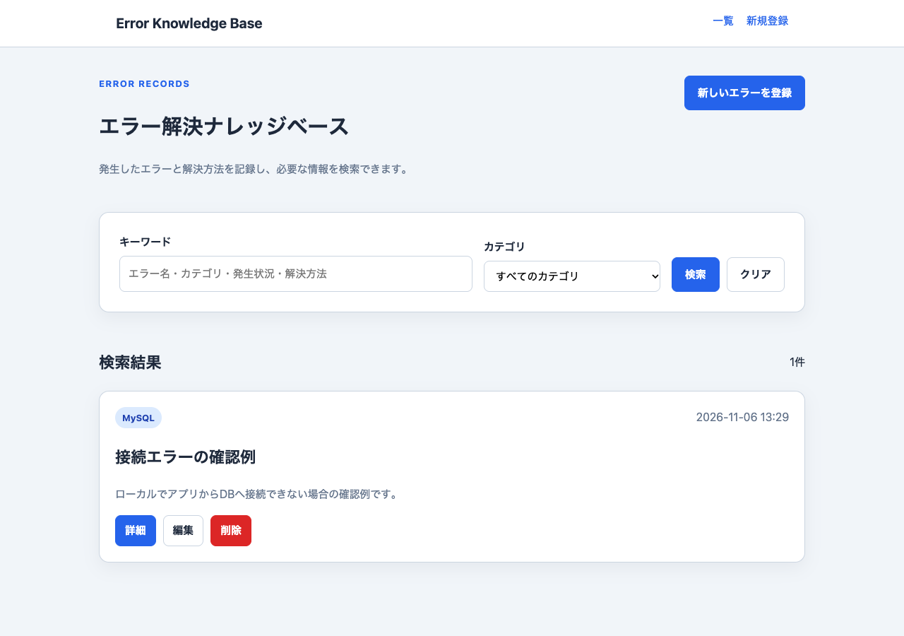
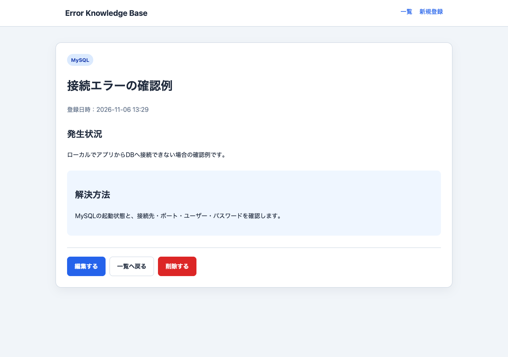
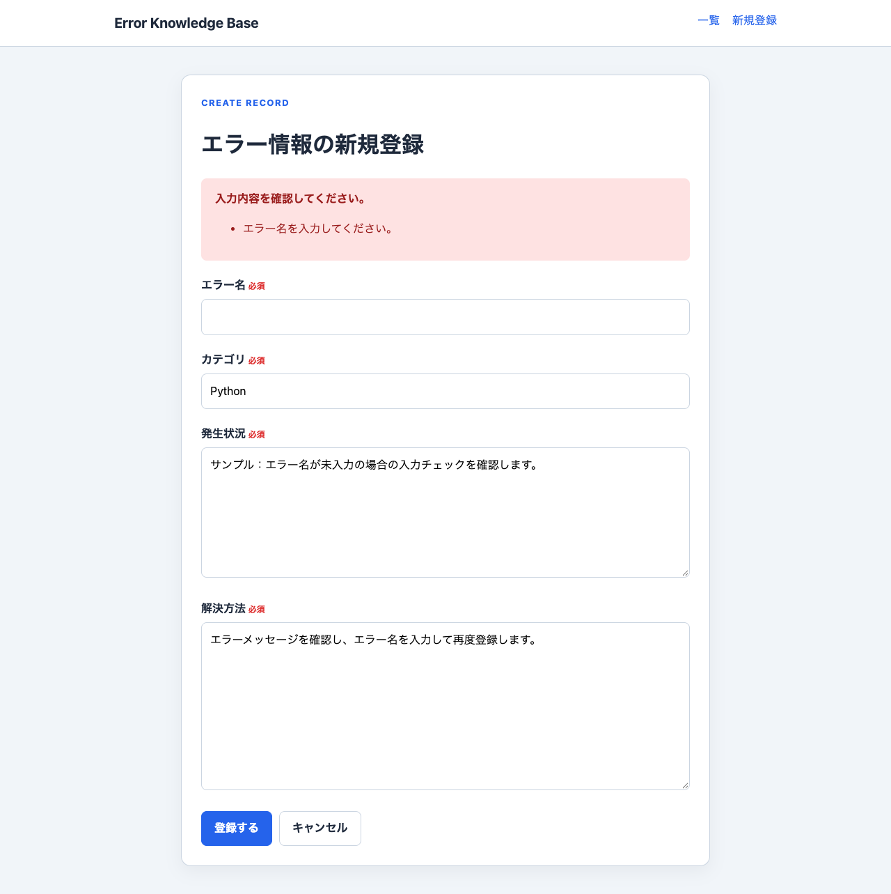

# エラー解決ナレッジベース

プログラミング中に発生したエラーの状況と解決方法を記録し、キーワードやカテゴリで探せるWebアプリです。HAL名古屋の授業課題を、インターン応募用に整理した学習作品です。

## 制作の目的

エラー名だけでなく、発生状況と解決方法をセットで残せるようにすることを目的としています。同じ問題が起きた際に、過去の記録を検索して参照する使い方を想定しています。

## 主な機能

- エラー情報の登録・一覧・詳細表示・編集・削除（CRUD）
- エラー名・カテゴリ・発生状況・解決方法を対象としたキーワード検索
- カテゴリによる絞り込み（キーワード検索との併用可）
- 必須入力と文字数のチェック、入力エラー時の内容保持
- 登録・更新・削除後の完了メッセージ、削除前の確認

## 画面

画像は動作確認用のサンプルデータを登録して撮影しています。

### 一覧・検索



### 詳細



### 入力チェック



## 使用技術・構成

| 用途 | 技術 |
| --- | --- |
| サーバー側 | Python / Flask |
| データ保存 | MySQL / mysql-connector-python |
| 画面 | HTML / CSS / Jinja2 |

```text
app.py                 ルーティング・入力チェック・DB操作
schema.sql             データベースとテーブルの作成
requirements.txt       Pythonの依存パッケージ
.env.example           環境変数の設定例
templates/            一覧・入力・詳細のテンプレート
static/style.css      画面のスタイル
docs/                 制作範囲・動作確認記録・画面画像
```

## 実装上のポイント

- 登録と編集で入力チェックを共通化しています。
- 前後の空白を除去し、必須項目と文字数上限をサーバー側でも確認します。
- 入力に不備がある場合、DBへの書き込みを行わず、入力内容を残してフォームを再表示します。
- SQLの値はプレースホルダで渡しています。
- 書き込み後は `commit()` で確定し、リダイレクトして一覧または詳細に移動します。
- 存在しないIDは404を返し、通常のSQL処理後は `finally` でカーソルと接続を閉じます。

## 制作について

学校の授業課題として、生成AIの支援を受けて制作しました。現在はコードの理解を進め、入力チェックからDB保存までの流れを学習しています。

## ローカルでの起動方法

Python、MySQLサーバー、MySQLクライアントが必要です。動作確認に使用したバージョンは [確認記録](docs/verification.md) を参照してください。以下はmacOS / Linuxのターミナル向けです。

### 1. Python環境を作る

リポジトリのフォルダに移動して実行します。

```bash
python3 -m venv .venv
source .venv/bin/activate
python -m pip install -r requirements.txt
```

### 2. DBと専用ユーザーを作る

MySQLサーバーを起動したうえで、管理ユーザーでスキーマを作成します。

```bash
mysql -u root -p < schema.sql
mysql -u root -p
```

MySQLのプロンプトで以下を実行してください。パスワード例は、自分のローカル環境用の値に置き換えます。

```sql
CREATE USER 'error_kb_app'@'localhost' IDENTIFIED BY 'replace-with-your-local-password';
GRANT SELECT, INSERT, UPDATE, DELETE ON error_knowledge_base_db.* TO 'error_kb_app'@'localhost';
EXIT;
```

### 3. 接続設定を用意する

```bash
cp .env.example .env
```

`.env` の `DB_PASSWORD` を手順2で決めた値に変更してください。`FLASK_SECRET_KEY` には、次のコマンドで生成した値を設定します。

```bash
python -c 'import secrets; print(secrets.token_hex(32))'
```

`.env` を現在のシェルに読み込み、アプリを起動します。`.env` は自動読み込みではありません。以下は自分で作成した設定ファイルに対して実行します。

```bash
set -a
source .env
set +a
python app.py
```

ブラウザで `http://127.0.0.1:5000` を開きます。初期状態は0件なので、新規登録からデータを追加してください。画像のサンプルデータは自動登録されません。終了はターミナルで `Ctrl+C` を押します。

`.env` はGitの除外対象です。実際のパスワードや秘密鍵をソースコード・README・画面画像に含めないでください。`FLASK_SECRET_KEY` が未設定の場合は起動時に一時的な値を生成するため、再起動すると以前のセッションは引き継がれません。

## 現在の制限と今後の改善

現状は個人のローカル学習用です。認証・ユーザーごとのアクセス制御・CSRF対策は未実装であり、インターネット上でそのまま運用する構成ではありません。

今後は、検索・更新・削除のコードの理解を進めたうえで、ページ分割、DB障害時の表示、認証・権限管理、CSRF対策などに取り組みたいと考えています。
